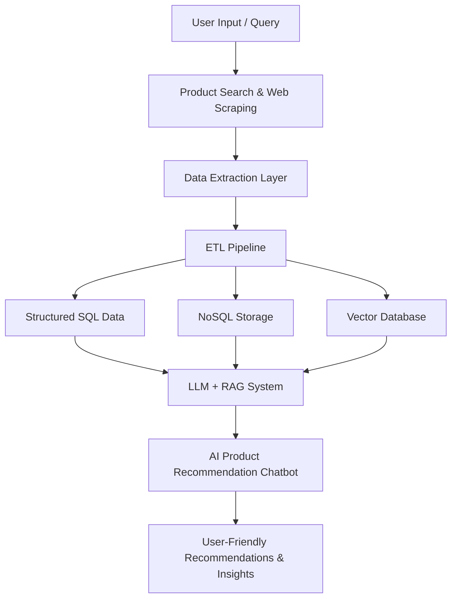
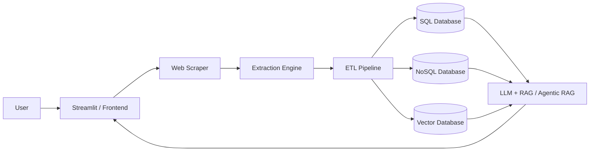

# E-commerce Product Assistant

## Overview

This project focuses on a real-world e-commerce challenge: helping users choose the right product when they are overwhelmed by too many options, inconsistent product information, and fragmented reviews across online stores.

The goal is to build an AI-powered shopping assistant that can:

- scrape product information from e-commerce platforms like Amazon and Flipkart
- extract product metadata, review content, pricing, and image details
- transform raw data into structured and query-ready formats
- store data in SQL, NoSQL, and vector databases for intelligent retrieval
- power a chatbot using LLM-based RAG or agentic RAG approaches
- guide users toward the best product choice based on preferences and use cases

This is designed as a personalized AI shopping advisor, similar to having your own ChatGPT for product discovery and purchase decisions.

---

## Business Problem

Buying a product online is not always straightforward. Customers often face:

- too many products to compare
- inconsistent or noisy metadata across websites
- misleading or incomplete descriptions
- large numbers of reviews without clear insight
- difficulty choosing between brands like HP, Lenovo, Dell, ASUS, and Apple

A person who wants to buy a laptop may ask:

> "I want a laptop for coding and office work. I am confused between HP, Lenovo, and Dell. Which one should I choose?"

Traditional e-commerce platforms provide product pages, but they do not deeply understand user intent, compare products intelligently, or provide personalized recommendations. This creates a strong need for an AI-assisted decision support system.

---

## Proposed Solution

This project proposes an intelligent product assistant that combines web data extraction, ETL pipelines, databases, and GenAI-powered reasoning.

The solution works in the following flow:

1. The user enters a product query or preference
2. The system scrapes product data from sources like Amazon and Flipkart
3. Relevant attributes are extracted, such as title, price, image, specifications, and reviews
4. Raw data is transformed into structured and searchable formats
5. Data is stored in SQL, NoSQL, and vector databases
6. A chatbot powered by LLM and RAG retrieves the most relevant context
7. The AI assistant compares products and recommends the best-fit option

This transforms online shopping from manual browsing into a guided AI-assisted decision process.

---

## Data Extraction and ETL Pipeline

### Data Sources

The system can ingest product information from:

- Amazon product pages
- Flipkart product pages
- product review sections
- metadata and specifications
- seller information
- image and product detail attributes

### Example Product Inputs

- iPhone
- HP Pavilion laptop
- Lenovo ThinkPad
- Dell Inspiron laptop
- MacBook Air

### Data to Extract

For each product, the system should capture:

- product title
- brand
- model
- price
- category
- image URL
- product description
- technical specifications
- rating and review count
- review text
- sentiment and product feedback

### ETL Process

#### Extract
- Pull product data and review content from e-commerce websites and APIs
- Capture raw, unstructured product information

#### Transform
- Clean noisy HTML and irrelevant content
- Normalize product fields
- Standardize pricing, categories, and metadata
- Generate embeddings for semantic retrieval
- Summarize or classify product reviews

#### Load
- Store structured metadata in SQL databases
- Store raw and semi-structured documents in NoSQL storage
- Store vector embeddings in a vector database for semantic search

This hybrid approach ensures both analytical processing and AI retrieval are supported.

---

## Storage Architecture

The system uses a multi-layer storage approach:

### 1. SQL Database
Used for structured, normalized records such as:

- product metadata
- price history
- product IDs
- categories
- brand mappings

### 2. NoSQL Database
Used for document-style and semi-structured product data:

- raw product pages
- reviews
- metadata variations
- unstructured content

### 3. Vector Database
Used for AI-powered retrieval:

- semantic search
- similar product matching
- retrieval for LLM-based reasoning
- RAG-driven answer generation

---

## GenAI and Chatbot Layer

The product assistant is powered by GenAI and LLM-based architectures.

### Classical RAG
In a classical RAG design:

- product and review data are indexed in a vector database
- user queries are converted into embeddings
- relevant product context is retrieved
- the LLM uses that context to answer questions

Examples of user questions:

- "Which laptop is best for coding under ₹60,000?"
- "Compare HP and Lenovo for student use"
- "Which phone has better battery life?"
- "Suggest a lightweight laptop for work travel"

### Agentic RAG
An agentic RAG approach goes further by:

- breaking queries into sub-tasks
- deciding when to fetch data, compare items, or ask clarifying questions
- reasoning across multiple product records before responding
- generating more contextual and personalized recommendations

This creates an assistant that behaves like a knowledgeable product advisor rather than a simple search tool.

---

## Example User Journey

### Scenario
A user wants to buy a laptop but is confused between multiple brands.

### Interaction Flow

1. User enters: "I want a laptop for daily work and programming. I am confused between HP, Lenovo, and Dell."
2. The assistant asks follow-up questions if needed:
   - budget
   - screen size preference
   - portability requirement
   - gaming or office use
3. The system scrapes product details from ecommerce marketplaces
4. It collects reviews, specs, and images for each candidate product
5. The ETL pipeline cleans the data and loads it into storage layers
6. The AI assistant compares products using review sentiment and metadata
7. The final response recommends the best option with explanation

Example response:

> "For your budget and use case, Lenovo offers the best balance of performance and portability, HP is better for design-focused users, and Dell is strong for business productivity."

This is the core value proposition of the application.

---

## Business Value

This project creates value for both shoppers and businesses:

- better product discovery
- faster and more informed buying decisions
- improved customer trust and engagement
- more personalized recommendations
- reduced confusion during purchase decisions
- better understanding of product sentiment from reviews
- stronger conversion from browsing to buying intent

---

## System Architecture

---

## High-Level Architecture Diagram

---

## Core Components

- Web scraping engine
- product extraction module
- ETL processing pipeline
- data transformation and normalization layer
- review analysis and sentiment extraction
- vector embedding generator
- semantic retrieval layer
- LLM-powered chatbot
- recommendation engine
- user-facing interface

---

## Project Goal

The long-term vision is to build a personalized AI shopping assistant that understands a user’s needs, compares products across platforms, and recommends the most appropriate choice with confidence.

In simple terms, this project aims to create a personal ChatGPT-style product advisor for e-commerce decision-making.

---

## Future Scope

- compare products across Amazon and Flipkart
- add price tracking and product trend analytics
- add personalized buyer profiles and memory
- support multilingual recommendations
- integrate voice-based shopping assistant
- expand to broader categories like electronics, fashion, home appliances, and grocery

---

## Summary

This project sits at the intersection of:

- web scraping
- ETL
- databases
- data engineering
- AI and LLMs
- RAG systems
- agentic reasoning
- e-commerce recommendation

It is not just a data scraper or a chatbot alone; it is an end-to-end AI-powered product intelligence platform designed to help users make smarter shopping decisions.

This README presents the business use case and solution vision before the technical implementation is added in later stages.
